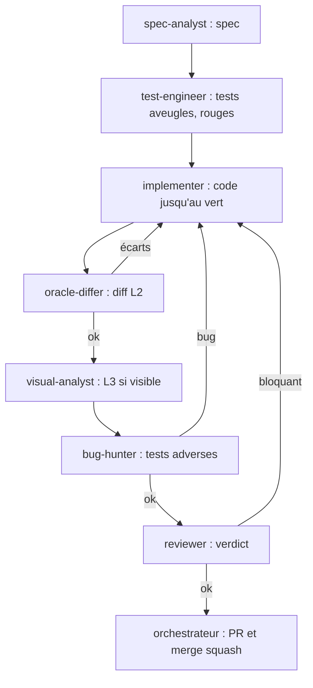

# Équipe de sous-agents

Les définitions exécutables des rôles sont versionnées dans le dossier d'agents du dépôt (un fichier par rôle). Ce document donne le principe, la répartition et la boucle de travail. Les agents ont un scope étroit, un contexte minimal et des sorties typées pour éviter les biais.

## Principes

1. **Séparation des rôles.** Celui qui spécifie, celui qui écrit les tests, celui qui implémente, celui qui relit et celui qui attaque sont des agents distincts avec des contextes distincts.
2. **Contexte minimal.** Un agent reçoit uniquement ce dont son rôle a besoin : spec, fichiers du scope, critères de fin. Pas l'historique de la conversation, pas les conclusions d'un autre agent.
3. **Aucune hypothèse transmise.** Un vérificateur ne reçoit jamais "je pense que le bug vient de X". Il reçoit le diff, la spec et les résultats bruts.
4. **Scope d'écriture strict.** Chaque rôle liste les chemins qu'il peut modifier. Hors scope, il signale au lieu de corriger.
5. **Preuve ou rien.** Toute affirmation est accompagnée d'une commande, d'un fichier ou d'une image reproductibles.
6. **Pas de travail inutile.** Le niveau de risque de la tâche (voir `docs/WORKFLOW.md`) détermine quels rôles interviennent.

## Rôles

| Rôle | Peut écrire | Mission | Ne fait jamais |
|---|---|---|---|
| `architect` | `docs/`, `*.gradle.kts`, `gradle/` | ADR, frontières de modules, contrats d'API, revue de structure | écrire du code métier |
| `spec-analyst` | `docs/specs/`, `docs/features/` | Distiller rapports, données et oracle en spec testable avec niveaux de preuve | lire ou citer l'implémentation |
| `implementer` | un module nommé dans le brief (`src/main`) | Implémenter une tâche à partir de la spec | modifier les tests, élargir son scope |
| `test-engineer` | `src/test` du module nommé | Écrire tests et vecteurs dorés depuis la spec, en aveugle | lire `src/main` du code testé |
| `oracle-differ` | `.cache/`, `reports/diff/`, `tools/diff` | Lancer l'oracle, comparer, localiser le premier écart, exécuter les scénarios | corriger le code, formuler de cause supposée comme un fait |
| `visual-analyst` | `reports/visual/` | Produire et lire des planches d'images, décrire les écarts | juger sans l'entrée écrite dans la légende |
| `reviewer` | rien (verdict en sortie) | Relecture non biaisée : justesse, propreté, taille, conventions, sécurité | recevoir le résumé de l'auteur, corriger lui-même |
| `bug-hunter` | `src/test` (tests de reproduction) | Attaque adverse : coordonnées négatives, bordures, overflow, déterminisme, concurrence | corriger le code |

L'orchestrateur (la session principale) crée les branches, rédige les briefs, route les livrables, ouvre et fusionne les PR. Il ne s'auto-valide pas : le verdict du `reviewer` est requis.

## Format d'un brief

Tout brief contient, dans cet ordre :

```
Objectif       : une phrase
Niveau de risque : A | B | C
Spec           : chemin(s) dans docs/specs/
Scope écriture : chemins autorisés
Hors scope     : ce qu'il ne doit pas toucher
Entrées        : diff, résultats de CI, rapports (bruts)
Critères de fin : liste vérifiable
Livrable       : format attendu
```

Interdit dans un brief : hypothèses sur la cause, jugement sur la qualité du code, résumé de ce que l'auteur "a voulu faire".

## Boucle de travail d'une tâche



Parcours selon le risque :

- **A** : tout le diagramme.
- **B** : `test-engineer` (peut être l'`implementer` si la logique est triviale), `implementer`, `reviewer`, oracle si observable.
- **C** : `implementer` (ou `architect` pour docs et build) puis `reviewer`.

Plafond de boucle : au bout de trois allers-retours implementer / vérificateur sans convergence, l'orchestrateur s'arrête, relit la spec et le diagnostic bruts, et reformule la tâche ou la spec au lieu de relancer.

## Parallélisme

Les tâches indépendantes (modules différents, fichiers disjoints) tournent en parallèle, chacune dans sa branche et idéalement son worktree. Deux écrivains ne touchent jamais les mêmes fichiers.

## Rapports attendus des vérificateurs

- `reviewer` : liste de constats classés `BLOQUANT` / `MAJEUR` / `MINEUR`, chacun avec fichier, ligne, preuve et correction suggérée ; conclusion `APPROUVÉ` ou `CHANGEMENTS REQUIS`.
- `bug-hunter` : pour chaque bug, un test de reproduction qui échoue et la commande pour le lancer ; sinon la liste des attaques tentées.
- `oracle-differ` : rapport au format de `docs/VERIFICATION.md`.
- `visual-analyst` : planche, légende complète, liste d'écarts observés (descriptifs, sans cause supposée).
