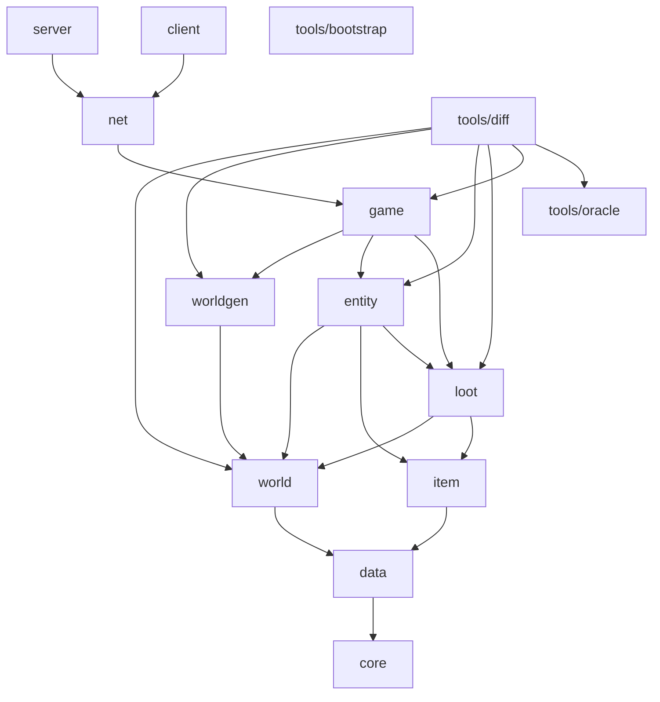
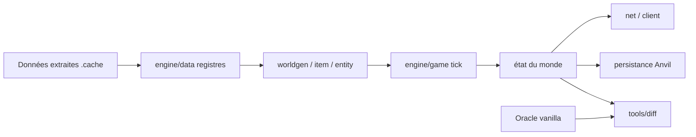

# Architecture

Cible : Minecraft Java 26.3 (data version 5023 et protocole 777 issus des rapports, à confirmer par `bootstrap`), Java 25. Ce document décrit l'organisation du code, pas le comportement du jeu (voir `docs/specs/`).

## Principes

1. **Données d'abord.** Les définitions vanilla (blocs, biomes, loot, recettes, worldgen JSON) sont chargées depuis les données extraites du jeu de référence, jamais recopiées dans le code. Le code implémente des interprètes et des algorithmes (ADR 0002, ADR 0003).
2. **Déterminisme.** À entrées égales, sortie identique bit à bit. Voir la section dédiée.
3. **Dépendances vers le bas.** Un module ne dépend que des modules plus bas dans le graphe. ArchUnit le vérifiera en CI dès le squelette Gradle (jalon M0) ; d'ici là, la règle est appliquée en revue.
4. **Moteur sans graphique.** Toute la logique de jeu vit dans `engine/*` et tourne sans fenêtre. Le client n'est qu'une vue.
5. **Petits modules lisibles.** Budgets de taille dans `docs/CONVENTIONS.md`.

## Modules

| Module | Responsabilité | Dépendances directes |
|---|---|---|
| `engine/core` | RNG (legacy, xoroshiro, positionnel), `Mth` et tables, identifiants, NBT (binaire et SNBT), géométrie, utilitaires | rien |
| `engine/data` | Infrastructure de chargement des datapacks : sources et priorités, arbres JSON, registres et références, combinateurs de codecs, tags (ADR 0005) | core |
| `engine/world` | Blocs et états, sections et palettes, chunks, heightmaps, lumière, fluides, ticks planifiés et aléatoires, stockage Anvil | data |
| `engine/item` | Objets et composants, inventaires, recettes | data |
| `engine/loot` | Tables de butin, prédicats, fournisseurs de nombres, valeurs d'enchantements, ports de contexte (ADR 0004) | world, item |
| `engine/worldgen` | Densité et bruit, sélection de biomes, surfaces, grottes, aquifères, features, structures, étapes de génération | world |
| `engine/entity` | Entités, attributs, effets de statut, physique, collisions, IA (goals et brain), spawn, dégâts | world, item, loot |
| `engine/game` | Boucle de tick, niveaux, joueurs, commandes, gamerules, avancements, persistance, actions d'enchantement | worldgen, entity, loot |
| `net` | Protocole 777, paquets, codecs, états de connexion | game |
| `server` | Point d'entrée du serveur dédié | net |
| `client` | Rendu LWJGL, audio, interface, entrées, resource packs, modèles | net |
| `tools/bootstrap` | Téléchargement vérifié et extraction des données de référence | aucun module du moteur |
| `tools/oracle` | Pilotage du vrai serveur de référence, production des états de référence | aucun module du moteur |
| `tools/diff` | Comparateurs d'état, cartes PNG, rapports de divergence, scénarios | engine/world, engine/worldgen, engine/entity, engine/loot, engine/game, tools/oracle |

Le décodage typé des données est fait par le module qui possède le type, pas par `data`, et les block entities à inventaire sont des comportements enregistrés par `game` dans `world` (ADR 0005).

Les dépendances transitives suivent le graphe (par exemple `game` atteint `core` via `world` et `data`). Les dépendances directes sont celles déclarées dans le `build.gradle.kts` du module.

`tools/oracle` n'importe aucun module du moteur : il embarque son propre lecteur minimal de NBT et d'Anvil. Si l'oracle lisait la référence avec notre code, un bug de lecture symétrique rendrait la comparaison aveugle (voir `docs/VERIFICATION.md`).

Graphe (flèche = "dépend de") :



`world` et `item` ne se connaissent pas. Une interaction objet/bloc passe par `entity` ou `game`. Les butins et valeurs d'enchantements sont évalués par `loot` via des ports (ADR 0004).

## Layout d'un module

```
engine/<module>/
  build.gradle.kts
  src/main/java/dev/shoko/minecraft/<module>/<sous-paquet>/
  src/test/java/dev/shoko/minecraft/<module>/<sous-paquet>/
```

Racine de paquets : `dev.shoko.minecraft`. Un sous-paquet par concept (`noise`, `biome`, `surface`, `carver`, `feature`, `structure` pour worldgen). Pas de paquet `util` fourre-tout : un helper vit à côté de son seul utilisateur, ou dans `core` s'il est partagé.

## Flux de données



## Déterminisme

- Pas d'itération sur `HashMap` / `HashSet` quand l'ordre influence le résultat : utiliser des collections ordonnées ou trier explicitement.
- Pas d'horloge système, pas de `Math.random`, pas de `ThreadLocalRandom` dans la logique de jeu. Toute source aléatoire est un RNG de `core` dont la graine et l'ordre de consommation sont explicites.
- Arithmétique : respecter `float` contre `double`, division entière et décalages de Java. Les fonctions trigonométriques et tables doivent reproduire les valeurs de référence (vérifiées par vecteurs dorés).
- Coordonnées négatives : toujours `Math.floorDiv` / `floorMod` ou décalages arithmétiques, jamais `/` et `%` sur des coordonnées de bloc.
- La parallélisation (génération de chunks) ne doit pas changer le résultat : le résultat d'un chunk dépend uniquement de la seed, des voisins déclarés de l'étape et des données.

## Concurrence

- Un thread de tick par serveur ; l'état du monde n'est modifié que par lui.
- La génération de chunks tourne sur des workers, étape par étape, avec des chunks voisins immuables en lecture pour l'étape en cours.
- Le client lit des instantanés, jamais l'état vivant.

## Erreurs

- Données invalides ou incohérentes au chargement : échec explicite avec l'identifiant fautif, jamais de valeur par défaut silencieuse.
- Invariants internes : `IllegalStateException` / assertions, pas de `catch` qui avale.
- Les comportements d'échec du jeu (génération qui échoue, placement refusé) font partie de la spec et sont reproduits, pas "corrigés".

## Décisions ouvertes

- API de rendu (OpenGL ou Vulkan via LWJGL) : tranchée par ADR au jalon M9.
- Format interne des états de bloc (tableau plat indexé ou objets internés) : tranché par ADR au jalon M3 sur mesure de performance.
